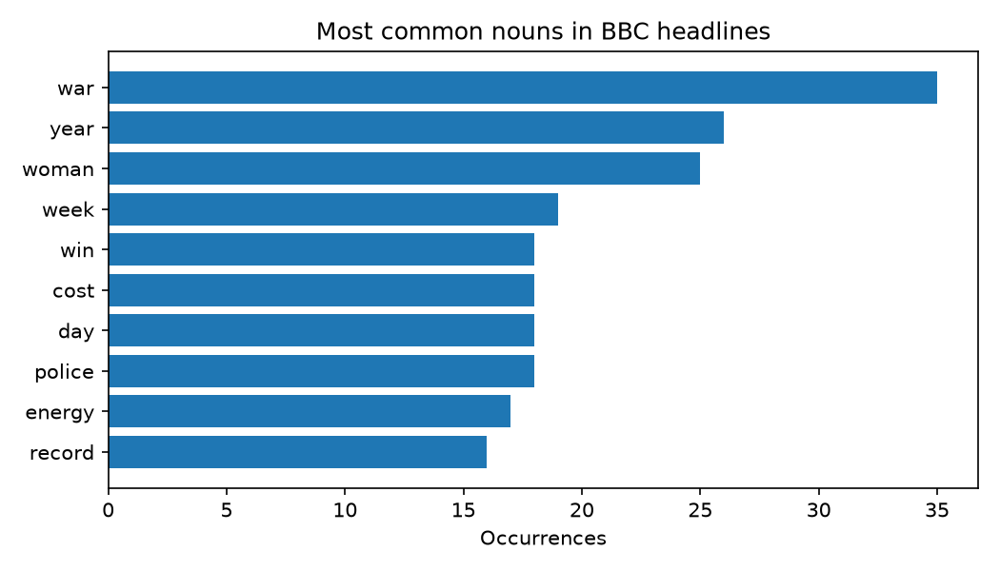
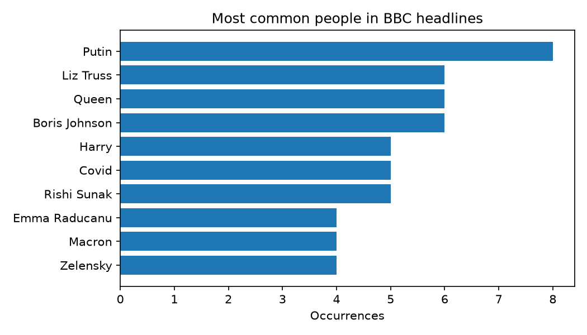

# BBC Headlines: Part-of-Speech Tagging & Named Entity Recognition

This project analyses ~1,000 BBC News headlines (2022–2023) with classical NLP
techniques to answer two questions:

1. **What kind of language do headlines use?** (part-of-speech tagging)
2. **Who and what are the headlines about?** (named entity recognition)

The headlines come from the BBC News RSS feed, stored in `data/bbc_news.csv`
(columns: `title`, `pubDate`, `guid`, `link`, `description`). Only `title` is used.

**👉 [Read the full walkthrough notebook](notebooks/bbc_headlines_pos_ner.ipynb)** to see the code, tables and charts rendered inline.

| Most common nouns (POS) | Most common people (NER) |
|---|---|
|  |  |

## The two core techniques

### Part-of-Speech (POS) tagging
POS tagging labels every word with its grammatical role: noun, verb, adjective, etc.
Words alone are ambiguous ("beat" can be a verb or a noun, "record" too), so the
tagger uses the surrounding sentence to decide.

Here it lets us ask grammatical questions of the corpus instead of just counting words:

- **Nouns** show the topics (war, energy, police, cost).
- **Verbs** show the actions headlines favour (say, win, find, beat).
- **Adjectives** show the framing (new, Russian, final, first).

Tokens are reduced to their lemma (`says`/`said` → `say`) so inflected forms are
counted together, and punctuation is ignored.

### Named Entity Recognition (NER)
NER finds spans of text that refer to real-world things and classifies them. We
report three classes:

| Label    | Meaning                        | Example            |
|----------|--------------------------------|--------------------|
| `PERSON` | People                         | Putin, Liz Truss   |
| `GPE`    | Countries, cities, states      | Ukraine, England   |
| `ORG`    | Companies, agencies, institutions | NATO, NHS, BBC  |

Counting entities gives a quick picture of who and where dominated the news in the period.

> **Caveat:** the small spaCy model (`en_core_web_sm`) makes mistakes on short,
> context-poor headlines, e.g. "Covid" is tagged `PERSON` and a person's name can come
> back as `ORG`. Treat the rankings as indicative, not exact. A larger model
> (`en_core_web_trf`) would improve this.

## Pipeline

1. **Load**: read titles, drop empties and duplicates.
2. **Clean** (`outputs/cleaned_titles.csv`): lowercase → remove stop words → remove
   punctuation → tokenize → lemmatize (NLTK). Used for the overall most-common-lemma view.
3. **Tag**: run spaCy over *each headline separately* (so context never bleeds between
   headlines) and extract POS tags and entities. POS and NER run on the original text,
   not the cleaned text, because removing stop words and punctuation destroys the
   grammatical clues the models rely on.
4. **Count and plot**: top 10 nouns, verbs, adjectives, people, places and organisations,
   saved as CSV and bar charts in `outputs/`.

## Running it

```bash
python3 -m venv .venv && source .venv/bin/activate
pip install -r requirements.txt
python -m spacy download en_core_web_sm
python src/analyze.py
```

For the step-by-step version with inline tables and charts, open
[`notebooks/bbc_headlines_pos_ner.ipynb`](notebooks/bbc_headlines_pos_ner.ipynb) (needs `pip install jupyter`). It reuses
the functions in `src/analyze.py`.

NLTK resources (`stopwords`, `wordnet`, `punkt_tab`) are downloaded automatically.

## Layout

```
data/       input dataset
src/        analysis script
notebooks/  walkthrough notebook (with saved outputs)
outputs/    generated CSVs and charts
```
