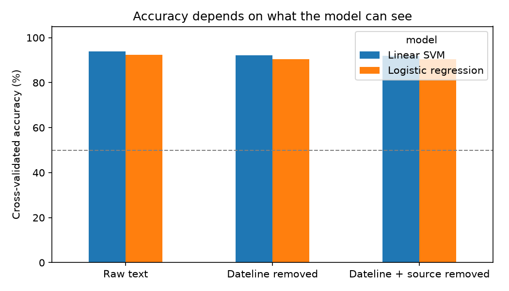
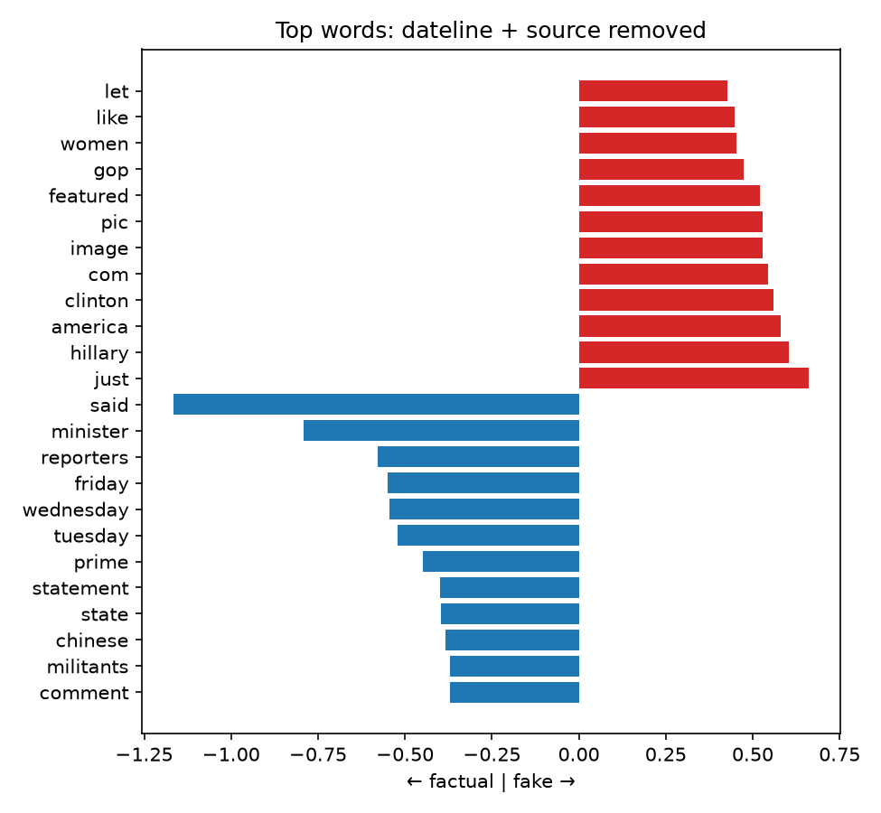

[← All projects](../README.md)

# Case Study: Classifying Fake vs. Factual News

**Scenario:** a social media company is worried about fake news on its platform. We
investigate how fake and factual articles differ, build a classifier to tell them apart, and
ask whether it can be trusted.

**👉 [Read the full walkthrough notebook](notebooks/fake_news_case_study.ipynb)** to see the code, tables and charts rendered inline.

| Accuracy depends on what the model sees | Words driving the prediction |
|---|---|
|  |  |

The data is `data/fake_news_data.csv`: 198 US political news articles (98 fake, 100
factual) with `title`, `text`, `date` and `fake_or_factual`.

## Techniques

This project pulls together methods from the other projects in this repo:

- **Part-of-speech tagging and named entity recognition** (spaCy) to compare writing style
  and who each type of article talks about.
- **Sentiment analysis** (VADER) to test whether fake news is more emotional.
- **TF-IDF + logistic regression / linear SVM** to classify, evaluated with repeated
  5-fold cross-validation.

## What we find

**How they differ**
- **Style:** fake news uses more pronouns (7.9% of words vs 5.1%) and adverbs (3.9% vs 2.4%),
  and fewer proper nouns (14.2% vs 17.0%). Factual news is denser in names and places.
- **Who they talk about:** factual articles mention places (U.S., Israel, Syria); fake ones
  focus on people (Clinton, Obama, McCain).
- **Sentiment does not separate them.** Both are about half negative, half positive.

**Classification**
- A TF-IDF classifier reaches **~90-94% accuracy** (balanced classes, 50% baseline).
- **Every factual article starts with a Reuters dateline** ("WASHINGTON (Reuters) -"), an easy
  giveaway. Removing it and all other mentions of Reuters costs only ~2 points (92% → 90%
  for logistic regression), so the model relies on more than that.
- **What it relies on is style, not truth.** The heaviest "factual" words are *said,
  minister, reporters, statement* and weekday names (wire-service vocabulary). The heaviest
  "fake" words are *com, pic, image, featured* (leftovers from embedded tweets and images)
  plus chatty partisan language (*hillary, gop, america*).
- It misclassifies 14 of 198 articles (7%) in cross-validation, in both directions. The
  notebook lists them.

**Implication:** the model separates *wire-service news* from *hyperpartisan blog posts*. It
has not learned what makes a claim false, and would probably fail on a fake story written in
a news-report style or on a factual article from a blog. Before deploying anything we would
need articles from many sources per class, spread over time, ideally with human fact-checks
as labels.

## Design choices

- **Cross-validation** (5 folds, repeated 10 times) instead of a single split, which is
  unreliable with 198 articles.
- **Vectorizer inside the pipeline**, so the vocabulary comes from training folds only.
- **Three versions of the text** (raw, dateline removed, dateline and source removed) to
  show how much a shortcut inflates the score. The `date` column is not used as a feature:
  its format differs by class ("Dec 30, 2015" vs "September 18, 2017"), another giveaway.
- **Not covered:** topic modelling (see [topic-modelling-lda-lsa](../topic-modelling-lda-lsa/)).

## Running it

From this folder:

```bash
python3 -m venv .venv && source .venv/bin/activate
pip install -r requirements.txt
python -m spacy download en_core_web_sm
python src/analyze.py
```

For the walkthrough, open [`notebooks/fake_news_case_study.ipynb`](notebooks/fake_news_case_study.ipynb)
(needs `pip install jupyter`).

## Layout

```
data/       input articles
src/        analysis script
notebooks/  walkthrough notebook (with saved outputs)
outputs/    charts and CSV summaries
```
