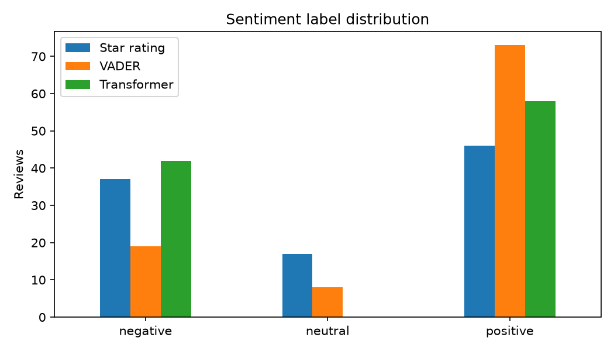
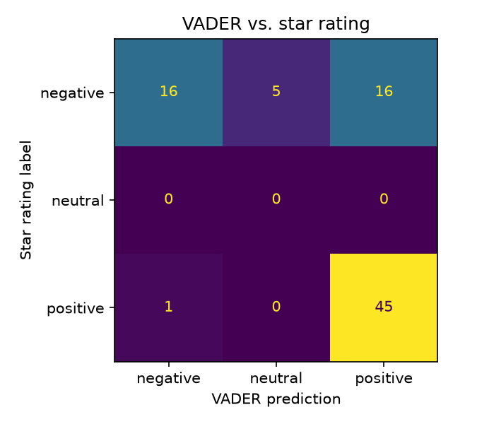
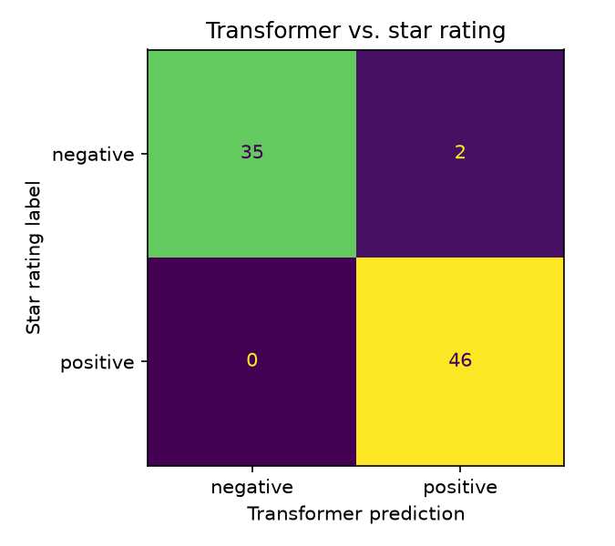

[← All projects](../README.md)

# Book Review Sentiment: VADER vs. a Transformer

This project scores the sentiment of 100 book reviews with two very different
approaches and checks how well each agrees with the star rating the reviewer gave.

**👉 [Read the full walkthrough notebook](notebooks/book_reviews_sentiment.ipynb)** to see the code, tables and charts rendered inline.

| Label distribution | Confusion matrix: VADER | Confusion matrix: Transformer |
|---|---|---|
|  |  |  |

The data is `data/book_reviews_sample.csv`: `reviewText` and a 1-5 star `rating`.

## Sentiment analysis

Sentiment analysis classifies text as **positive**, **negative** or **neutral**. Two common
approaches are compared:

### Rule-based: VADER
VADER looks words up in a sentiment lexicon and adjusts the score for capitalisation,
punctuation ("great!!!") and simple negation ("not good"). It returns a *compound* score
from -1 to +1, which we bucket into negative / neutral / positive (±0.05).
It is fast, needs no training and is easy to explain, but it works word by word.

### Pre-trained transformer
A DistilBERT model fine-tuned for sentiment (SST-2) reads each review in context, so it
understands things like "not worth the time". It is slower and heavier to install, and it
only answers positive or negative, with no neutral class.

## How we evaluate

Reviews come with star ratings, which gives us a ground truth: 1-2 stars = negative,
4-5 = positive. 3-star reviews are excluded from accuracy numbers because they have no clear polarity.

## Results (83 clearly positive/negative reviews)

| Method | Accuracy-style summary |
|---|---|
| VADER | Recalls 98% of positive reviews but only 43% of negative ones |
| Transformer | ~98% on both classes |

VADER's main weakness is negation and context: "not worth the time" or "I did not like
it" contain positive words, so negative reviews often get scored positive or neutral.
The transformer handles these. See the notebook for examples.

Note this is a small sample (100 reviews), so treat the numbers as indicative.

## Design choices

- VADER runs on the **raw text**, not lowercased or punctuation-stripped text, since it
  uses capitalisation and punctuation as signals.
- The transformer model is pinned by name for reproducibility; reviews longer than the model's limit are truncated.

## Running it

From this folder:

```bash
python3 -m venv .venv && source .venv/bin/activate
pip install -r requirements.txt
python src/analyze.py
```

The first run downloads the transformer model (~270 MB). For the walkthrough, open
[`notebooks/book_reviews_sentiment.ipynb`](notebooks/book_reviews_sentiment.ipynb)
(needs `pip install jupyter`).

## Layout

```
data/       input dataset
src/        analysis script
notebooks/  walkthrough notebook (with saved outputs)
outputs/    scored reviews, charts
```
