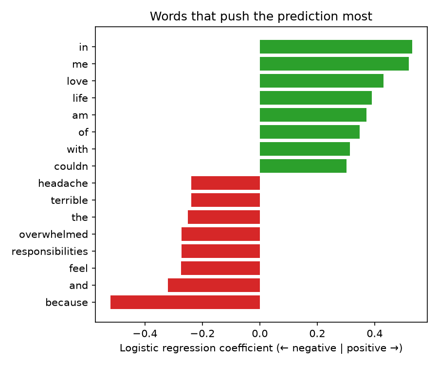

[← All projects](../README.md)

# A Custom Text Classifier with Logistic Regression

This project builds a text classifier from scratch: 20 hand-written sentences labelled
positive or negative, turned into word-count features and fed to a logistic regression.
The interesting part is not the model but what happens when the data is this small.

**👉 [Read the full walkthrough notebook](notebooks/logistic_regression_classifier.ipynb)** to see the code, tables and charts rendered inline.



The data is `data/sentences.csv`: 10 positive and 10 negative everyday sentences.

## The technique

**Supervised text classification** learns a mapping from text to a label using labelled
examples. The recipe:

1. **Vectorize:** turn each sentence into word counts (bag of words).
2. **Train:** logistic regression learns one weight per word. A positive weight pushes a
   sentence towards "positive", a negative one towards "negative". The weighted sum is
   converted to a probability.
3. **Evaluate:** measure how well it labels sentences it has never seen.
4. **Predict:** label new text and report a confidence.

## What we find

With only 20 sentences the classifier **does not learn to tell positive from negative**:

- **A single 70/30 split** puts 6 sentences in the test set, so one wrong answer moves
  accuracy by 17 points. The result is essentially luck (33% in our split).
- **Repeated 5-fold cross-validation** gives a steadier estimate: about **43% accuracy**
  on a balanced two-class problem, which is no better than a coin flip. Swapping in
  TF-IDF, stop-word removal or bigrams doesn't help.
- **The learned weights show why.** Many of the heaviest words are filler ("in", "me",
  "and", "because"). Each content word ("promotion", "headache") appears in a single
  sentence, so the model can't separate words that carry sentiment from words that
  merely happen to separate the training examples. Words it hasn't seen get no weight.
- **New sentences get low-confidence predictions** (50-70%), some wrong: "my team won the
  final" comes out negative. "I am not happy" comes out positive because bag of words
  ignores word order, so it cannot see negation.

What would help: far more labelled examples, or pre-trained representations
(word embeddings or a transformer) that already know "happy" and "joyful" are related.
Compare with the [book reviews sentiment project](../sentiment-book-reviews/), where a
pre-trained model gets ~98% without any training data of our own.

## Design choices

- **Vectorizer and classifier in one pipeline.** The vocabulary is learned from training
  sentences only. Fitting the vectorizer on all the data before splitting would leak
  test-set words into training.
- **Stratified split**, so train and test each get equal numbers of both classes.
- **Cross-validation** (5 folds, repeated 20 times) rather than trusting one split.
- Fixed random seed for reproducible results.

## Running it

From this folder:

```bash
python3 -m venv .venv && source .venv/bin/activate
pip install -r requirements.txt
python src/analyze.py
```

For the walkthrough, open [`notebooks/logistic_regression_classifier.ipynb`](notebooks/logistic_regression_classifier.ipynb)
(needs `pip install jupyter`).

## Layout

```
data/       labelled sentences
src/        analysis script
notebooks/  walkthrough notebook (with saved outputs)
outputs/    cross-validation scores, word weights, predictions, charts
```
