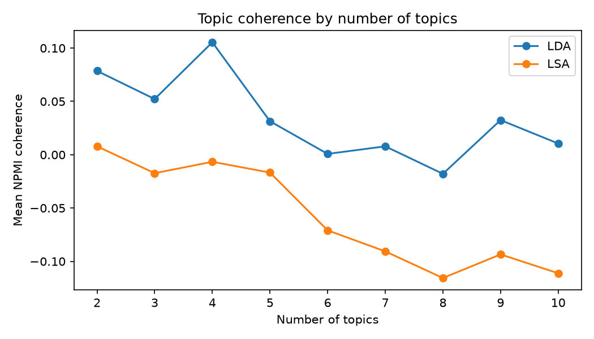

[← All projects](../README.md)

# Topic Modelling: LDA vs. LSA

Given 100 news articles and no labels, can we discover what they are about? This project
uses two topic-modelling techniques to find recurring themes and compares them.

**👉 [Read the full walkthrough notebook](notebooks/topic_modelling_lda_lsa.ipynb)** to see the code, tables and charts rendered inline.



The data is `data/news_articles.csv`: 100 New York Times articles (`id`, `title`, `content`).

## The two techniques

Both start from a document-term matrix (which words appear in which articles) and compress
it into a small number of topics.

### LDA: Latent Dirichlet Allocation
A probabilistic model. It assumes every article is a *mixture* of topics and every topic is
a *distribution over words*, then infers both from the word counts. Topics come out as
lists of words with positive weights, which makes them easy to read.

### LSA: Latent Semantic Analysis
Linear algebra instead of probability. It applies a truncated SVD to the (TF-IDF weighted)
term-document matrix, finding the directions along which words and articles vary most.
It is fast and deterministic, but topics are directions with positive *and* negative word
weights, so they are harder to interpret.

## Pipeline

1. **Clean:** lowercase, keep alphabetic words of 3+ letters, remove stop words and
   newswire filler ("said", "going"...), lemmatize.
2. **Vectorize:** bag-of-words counts for LDA, TF-IDF for LSA. Words in fewer than 3 or
   more than half of the articles are dropped.
3. **Choose the number of topics:** both methods need it up front. We try 2 to 10 and score
   each with *coherence* (NPMI): whether a topic's top words tend to appear in the same
   articles.
4. **Fit and inspect:** print each topic's top words and the articles that load most
   strongly on it.

## What we find

LDA's best coherence is at 4 topics, and they are readable (labels are our interpretation):

| Topic | Top words | Articles about |
|---|---|---|
| 1 | city, police, officer, official, team | Local news, crime, sport |
| 2 | trump, republican, party, company, government | US politics and campaign |
| 3 | government, saudi, united, percent, islamic | International affairs, economy and finance |
| 4 | show, life, weight, song, book | Culture, entertainment, health |

LSA is less clear-cut. Its coherence is lower at every size, and its first topic is mostly
a mix of the most common themes ("trump", "government", "city"). That is typical:
LSA's first component captures the overall dominant vocabulary rather than one theme.

Caveats: 100 articles is small, so coherence differences between topic counts are modest
and the results shift with preprocessing choices. Treat the chosen number of topics as a
starting point and judge topics by reading them.

## Design choices

- **scikit-learn instead of gensim.** `LatentDirichletAllocation` and `TruncatedSVD`
  (which is LSA) do the same job, and gensim currently fails to install on recent Python
  versions. The coherence measure is implemented in `src/analyze.py`.
- **Lemmatization instead of stemming.** Speed isn't an issue at this size, and lemmas
  stay readable ("police" rather than "polic").
- **TF-IDF for LSA, raw counts for LDA.** Each is the usual input for its model.
- Fixed random seed for reproducible results.

## Running it

From this folder:

```bash
python3 -m venv .venv && source .venv/bin/activate
pip install -r requirements.txt
python src/analyze.py
```

For the walkthrough, open [`notebooks/topic_modelling_lda_lsa.ipynb`](notebooks/topic_modelling_lda_lsa.ipynb)
(needs `pip install jupyter`).

## Layout

```
data/       input articles
src/        analysis script
notebooks/  walkthrough notebook (with saved outputs)
outputs/    topic words, article assignments, coherence scores, charts
```
