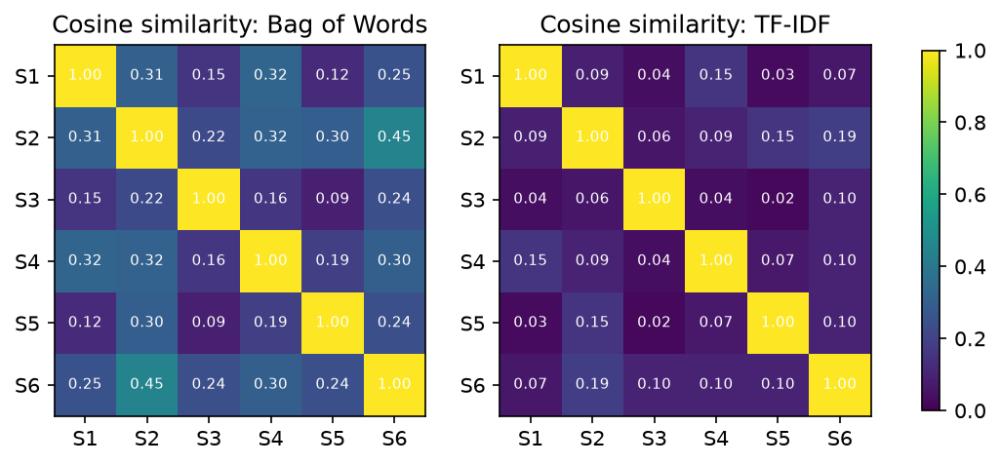

[← All projects](../README.md)

# Vectorizing Text: Bag of Words vs. TF-IDF

Machine learning models work with numbers, not words. This project turns six short
sentences into numeric vectors with two classic methods and compares what each one captures.

**👉 [Read the full walkthrough notebook](notebooks/bow_vs_tfidf.ipynb)** to see the code, tables and charts rendered inline.



The input is `data/sentences.txt`: six unrelated sentences, one per line.

## The two methods

### Bag of Words (BoW)
Build a vocabulary of every distinct word, then represent each sentence as the count of
each word in it. Word order is discarded, hence "bag". It's simple and fast, but common
words like "the" dominate the counts even though they say little about the content.

### TF-IDF
Starts from the same counts (term frequency, TF) and multiplies each by an *inverse
document frequency* (IDF): words that appear in many sentences are scaled down, words
that appear in few are scaled up. Each sentence vector is also length-normalised so long
sentences don't dominate. The result emphasises words that are distinctive to a sentence.

## What we find

- **BoW's top words are filler.** "the", "of" and "as" lead most sentences.
- **TF-IDF surfaces the distinctive words** ("blood", "carol", "drank"; "road", "ahead"),
  but "the" still ranks high in two sentences. With only six sentences nearly every
  word is rare, so IDF has little to compare against. TF-IDF needs a larger corpus to
  shine.
- **Stop-word removal fixes it here.** With `stop_words="english"`, TF-IDF's top terms are
  all content words ("bait", "gruff", "grumbling"; "directions", "mountains").
- **Similarity:** the six sentences are unrelated, so ideally none would look similar.
  Under BoW the average pairwise cosine similarity is 0.25 (driven by shared words like
  "the"), under TF-IDF 0.09, and with stop words removed 0.00.

Note the default tokenizer lowercases text and drops single-character tokens, so "a" is
not in the vocabulary.

## Running it

From this folder:

```bash
python3 -m venv .venv && source .venv/bin/activate
pip install -r requirements.txt
python src/analyze.py
```

For the walkthrough, open [`notebooks/bow_vs_tfidf.ipynb`](notebooks/bow_vs_tfidf.ipynb)
(needs `pip install jupyter`).

## Layout

```
data/       input sentences
src/        analysis script
notebooks/  walkthrough notebook (with saved outputs)
outputs/    BoW and TF-IDF matrices as CSV, similarity chart
```
